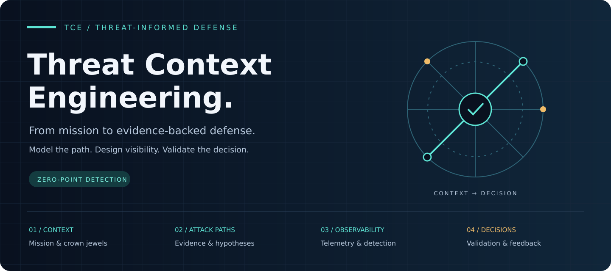

  

<h1 align="center">Cyber Threat Context Modeling</h1>

<strong>Connect threat intelligence, architecture and detection in one traceable decision system.</strong>

  <a href="#quick-start">Get started</a> ·
  <a href="docs/methodology.md">Explore the method</a> ·
  <a href="docs/horizon.md">Discover Horizon</a> ·
  <a href="docs/reference-cases.md">Run a reference case</a>

  
  
  
  

---

> **Model the threat before the first log.** Decide what must be observable, then engineer detections around attack sequences.

| **01 · Understand** | **02 · Engineer** | **03 · Decide** |
| :--- | :--- | :--- |
| Connect mission, crown jewels, architecture and evidence. | Turn plausible attack paths into controls, telemetry contracts and detections. | Validate coverage, expose gaps and trace each defensive decision. |
| [Threat context →](docs/threat-context-matrix.md) | [Detection as code →](docs/detection-validation-as-code.md) | [Decision Trace →](docs/decision-trace.md) |

### Choose your entry point

- **Learn the method:** start with the [analyst workflow](docs/analyst-workflow.md).
- **Try the toolkit:** follow the [quick start](#quick-start) and [CLI commands](#analyst-toolkit).
- **Explore enterprise defense:** inspect [Horizon](docs/horizon.md) and [Detection by Absence](docs/detection-by-absence.md).

**Analytical boundaries:** priority ≠ confidence; forecast pressure ≠ attack probability. AI and external intelligence remain review candidates until accepted by an analyst.

## Why this repository exists

Traditional threat modeling is often trapped at design time. Detection engineering is often trapped after telemetry exists. CTI is often trapped in reports. TCE turns those disconnected activities into one traceable decision system.

This project connects all three.

**Core idea:**

> Model the threat before the first log, decide what must be observable, then engineer detections around attack sequences instead of isolated events.

This is the repository's **Zero-Point Detection** principle.

~~~mermaid
flowchart TB
    A["Mission & crown jewels"] --> B["Architecture & threat context"]
    B --> C["Evidence & candidate paths"]
    C --> D["Controls & telemetry contracts"]
    D --> E["Detections & validation"]
    E --> F["Defensive decisions"]
    F -->|"Gaps & intelligence feedback"| B
    classDef context fill:#102638,stroke:#5de4d4,color:#f2f6fc
    classDef decision fill:#30271b,stroke:#f0bc69,color:#fff3da
    class A,B,C,D,E context
    class F decision
~~~

## The method

The proposed method is called **Threat Context Engineering (TCE)**.

TCE is broader than application threat modeling. It combines:

1. **Mission and decision context** — what must be protected and what decision the analysis must support.
2. **Intelligence Requirements** — the questions that must be answered to support that decision.
3. **Crown-jewel analysis** — the data, identities, systems, processes, and dependencies whose compromise creates unacceptable impact.
4. **Architecture context** — trust boundaries, identities, control planes, dependencies, exposure, data flows, third parties, cloud/SaaS and operational technology.
5. **Evidence and threat hypotheses** — explicit provenance, supporting and contradicting evidence, assumptions, unknowns, and confidence.
6. **Attack-path modeling** — how an adversary could sequence behaviors across the architecture to reach an objective.
7. **Prioritization and choke points** — which scenarios deserve attention and where defensive investment changes several paths at once.
8. **Defensive architecture** — preventive, constraining, detective, disruptive, recovery, and resilience controls.
9. **Telemetry engineering** — what events, fields, entities, context, integrity, and latency must exist for a threat to be observable.
10. **Detection engineering** — hypotheses, analytics, correlations, chains, triage, and response.
11. **Validation and coverage** — evidence that telemetry, detections, controls, and response behave as expected.
12. **Decision Trace and continuous feedback** — every defensive decision remains traceable to requirements, evidence, hypotheses, scenarios, gaps, and validation.

### TCE operating pipeline

| Stage | Main question | Output |
|---|---|---|
| 0. Mission & Decision | What must not fail and what decision is needed? | Mission + decision context |
| 1. Intelligence Requirements | What must we know? | Prioritized IRs |
| 2. Crown Jewels | What creates unacceptable impact if compromised? | Critical asset register |
| 3. Architecture | Where does risk actually live? | Nodes, relationships, trust boundaries |
| 4. Evidence | What do we actually know and from where? | Evidence lineage |
| 5. Hypotheses | What plausible proposition should be tested? | Threat hypotheses + confidence |
| 6. Attack Paths | How could compromise unfold? | Graph / Attack Flow candidates |
| 7. Prioritization | What matters first? | Priority separate from confidence |
| 8. Choke Points | Where do critical paths converge? | Defensive leverage points |
| 9. Defensive Design | What should stop, constrain, expose, or recover? | Control mapping |
| 10. Telemetry | What must be observable? | Telemetry contracts |
| 11. Detection | What behavior and sequence should trigger action? | Detection specifications + implementations |
| 12. Validation | Did the control and detection actually work? | Validation evidence |
| 13. Gaps & Decision Trace | What remains unknown and why are we acting? | Backlog + auditable decision chain |

## What makes this different

TCE intentionally joins areas that are usually treated as separate disciplines:

- **Threat Modeling Manifesto** for the four core questions and iterative mindset.
- **MITRE ATT&CK** for adversary behavior vocabulary.
- **CTID Threat Modeling with ATT&CK** for theory + evidence and critical-asset-driven analysis.
- **Attack Flow** for sequencing adversary behavior.
- **MITRE D3FEND** for engineering-oriented defensive countermeasure vocabulary.
- **NIST CSF / SP 800-53** for controls, governance, and risk treatment.
- **STRIDE, PASTA, Attack Trees, DFDs** when they are useful.
- **Detection engineering** as a first-class design output, not an afterthought.
- **CTI** as continuous evidence, not decoration at the end of a risk document.

TCE is **framework-compatible, not framework-dependent**.

## Zero-Point Detection

The detection pipeline starts **before telemetry exists**.

~~~mermaid
flowchart LR
    TM[Threat model] --> LOG[Required telemetry]
    LOG --> CHAIN[Behavior chain]
    CHAIN --> CASE[Detection use case]
    CASE --> TEST[Validation]
~~~

Instead of asking only:

> "What logs do we already have?"

TCE asks:

> "What must we be able to observe if this attack path happens?"

That changes telemetry from a passive data source into an explicit security requirement.

## Prioritization

TCE separates **priority** from **confidence**.

A scenario can be high priority even when evidence is incomplete, and strong evidence does not automatically mean high business impact.

The default model scores each dimension from 0–5:

- Crown-jewel criticality
- Threat relevance
- Attack-path feasibility
- Exposure
- Control weakness
- Detection gap

See [Prioritization Model](docs/prioritization.md).

## Explore the repository

| Start here | What you will find |
| :--- | :--- |
| [Method & workflow](docs/methodology.md) | The analytical process, from mission to decision |
| [Horizon](docs/horizon.md) | Enterprise paths, blind spots and defensive action candidates |
| [Reference cases](docs/reference-cases.md) | Identity, cloud, supply chain, AI agents, SaaS and ICS/OT |
| [Templates](templates/) | Reusable analytical artifacts |
| [Analyst toolkit](docs/case-model.md) | Case model and CLI operations |
| [Knowledge base](awesome/README.md) | Frameworks, tools, research and learning resources |

## Quick start

1. Copy the templates from [templates/](templates/).
2. Define mission and crown jewels.
3. Map architecture, trust boundaries, identities and dependencies.
4. Build threat hypotheses using both **theory** and **evidence**.
5. Convert hypotheses into ATT&CK-linked attack paths.
6. Prioritize scenarios.
7. Define controls and required telemetry.
8. Write detection hypotheses and correlations.
9. Validate safely in an authorized environment.
10. Feed results back into CTI and architecture decisions.

## Analyst toolkit

Install the repository in editable mode and operate directly on a TCE Case:

~~~bash
pip install -e .

tce validate examples/cases/enterprise-identity
tce score examples/cases/enterprise-identity
tce graph examples/cases/enterprise-identity
tce gaps examples/cases/enterprise-identity
tce coverage examples/cases/enterprise-identity
tce chokepoints examples/cases/enterprise-identity
tce trace examples/cases/enterprise-identity DEC-001
tce report examples/cases/enterprise-identity --audience executive --output executive.md
tce dashboard examples/cases/enterprise-identity --output dashboard.html
~~~

The CLI currently provides semantic validation, priority scoring, graph export, intelligence and telemetry gap discovery, multi-dimensional detection coverage, defensive choke-point analysis, Decision Trace, audience-specific Markdown reports, and a self-contained analyst dashboard.

## First-class analytical objects

- **Threat Context** — the lens that connects mission, crown jewels, architecture, external CTI, behavior, exposure, defensive requirements and time.
- **Environment State** — a time-stamped enterprise graph of assets, identities, trust, controls, telemetry, vulnerability and accepted intelligence signals.
- **Intelligence Requirement** — the question tied to a decision.
- **Evidence** — observed, assessed, inferred, assumed, or unknown information with provenance.
- **Threat Hypothesis** — a falsifiable proposition with supporting and contradicting evidence.
- **Attack Path** — a behavior sequence tied to architecture nodes and trust boundaries.
- **Telemetry Contract** — what must be observable, including fields and integrity requirements.
- **Detection Use Case** — behavior, correlation, triage, response, and coverage by dimension.
- **Detection Specification** — platform-neutral analytic contract linking scenario, telemetry, correlation logic, implementations, and validation.
- **Validation** — evidence that a control or detection behaves as expected.
- **Intelligence Gap** — an unknown turned into managed collection work.
- **Decision** — the defensive action connected back to the analytical chain.
- **Preemptive Action** — a review-gated defensive proposal linking controls to enterprise paths, crown jewels, estimated reduction and cost.

## Capability evolution

<strong>Explore v0.3 → v0.5: AI, interoperability, detection as code and Horizon</strong>

## TCE v0.3 — AI + operational knowledge graph

v0.3 adds a Colab-ready intelligence workbench:

- **GLiNER ON by default** for zero-shot entity extraction.
- **Qwen ON by default** for evidence-grounded analytical suggestions.
- immutable Evidence Packets so AI cannot silently rewrite source evidence;
- deterministic ATT&CK STIX validation and technique search;
- D3FEND inferred defensive mappings;
- Attack Flow STIX 2.1 export;
- ATT&CK Navigator layer export;
- TCE STIX 2.1 export and an explicit-review OpenCTI bridge;
- operational knowledge graph export to JSON, GraphML and RDF/Turtle.

~~~bash
tce standards-sync
tce attack-validate examples/cases/enterprise-identity
tce kg examples/cases/enterprise-identity --format ttl --output tce-kg.ttl
tce export-attack-flow examples/cases/enterprise-identity TS-001 --output flow.json
tce export-stix examples/cases/enterprise-identity --output case.stix.json
~~~

OpenCTI is dry-run by default. AI outputs are review candidates by default.

## TCE v0.3.1 — intelligence synchronization

The remaining v0.3 interoperability layer is now operational:

- ATT&CK **Detection Strategies**, **Analytics**, **Data Components**, log sources and mutable elements;
- Attack Flow **import and export**;
- OpenCTI → local snapshot → entity resolution → TCE evidence-candidate workflow;
- reviewed TCE → STIX → OpenCTI publication path;
- read-only TAXII 2.1 collection ingestion;
- deterministic entity resolution before CTI is linked into the case.

~~~bash
tce attack-detect T1078

tce import-attack-flow flow.json --output imported-scenario.yaml

tce opencti-pull --output opencti-snapshot.json
tce opencti-resolve opencti-snapshot.json examples/cases/enterprise-identity
tce opencti-to-tce opencti-snapshot.json --output opencti-evidence-candidates.yaml

tce taxii-pull https://example/taxii/root/collections/COLLECTION-ID \
  --output taxii-bundle.json
~~~

All inbound intelligence remains **candidate material until analyst review**. External CTI is not silently promoted into organizational fact, and AI still cannot rewrite evidence.

## TCE v0.3.2 — Threat Context Matrix

TCE now treats **Threat Context** as a first-class analytical object instead of assuming that every threat model is primarily an application or architecture model.

The new matrix spans:

- mission and business context;
- architecture and trust;
- adversary and campaign relevance;
- behavior and attack-path context;
- exposure and dependency context;
- defensive and telemetry context;
- evidence and confidence;
- resilience and recovery;
- temporal validity.

The built-in catalog contains more than twenty lenses, including Identity, Cloud, AI/GenAI, Web/API, Software Supply Chain, Detection & Validation, ICS/OT, IoT/Embedded, Endpoint, Network, Data, Collaboration, Third-Party/SaaS, Kubernetes, Developer/CI/CD, Cryptography, Recovery, Human/Process, Mobile, Telecommunications and the Security Control Plane.

Eight of those lenses map directly to **RedFrameworks v6 domain packs**. RedFrameworks remains the external catalog; TCE uses it as a review-gated context provider.

~~~bash
tce context-catalog
tce context-assess examples/cases/enterprise-identity
tce redframeworks-sync
tce context-enrich examples/cases/enterprise-identity --output context-intelligence.json
~~~

External actor, campaign, detection and validation metadata remains **candidate context** until local evidence establishes relevance.

## TCE v0.4 — Detection & Validation as Code

v0.4 closes the operational loop from prioritized threat scenario to reproducible defensive evidence.

New capabilities:

- first-class `DSP-*` **Detection Specification** objects;
- portable correlation-pattern library;
- Sigma export while keeping TCE as the platform-neutral source of truth;
- platform implementation references for Microsoft Sentinel, Splunk, Elastic and other targets;
- executable Telemetry Contract health scoring;
- conceptual field bridges for OCSF, ECS, Microsoft ASIM and Splunk CIM;
- deterministic validation harness for safe fixtures and log replay;
- historical coverage / telemetry / validation snapshots and drift comparison;
- scenario-to-detection engineering backlog;
- continuous RedFrameworks/TCE external context drift comparison;
- six executable reference cases across identity, cloud, software supply chain, AI agents, critical SaaS and ICS/OT;
- executable TCE conformance levels and a 1.0 specification draft.

~~~bash
tce conformance examples/cases/enterprise-identity --level validated
tce telemetry-health examples/cases/enterprise-identity
tce detection-backlog examples/cases/enterprise-identity
tce sigma-export examples/cases/enterprise-identity DSP-001 --output dsp-001.yml
tce validation-run examples/cases/enterprise-identity VAL-001
tce snapshot examples/cases/enterprise-identity --output snapshot.json
~~~

The core chain is now executable:

~~~text
Threat Context
  -> Threat Scenario
  -> Observable
  -> Telemetry Contract
  -> Detection Specification
  -> Platform Implementation
  -> Validation Evidence
  -> Decision / Gap
~~~

Validation operates on defensive event fixtures and log-replay data. The repository does not need command-level attack execution to prove that a detection model is internally consistent.

## TCE v0.5 — Horizon: predictive and preemptive enterprise defense

v0.5 adds **TCE Horizon**, the enterprise layer that moves threat modeling beyond a single application.

Horizon models the current environment as a directed defensive graph of assets, identities, trust relationships, crown jewels, controls, telemetry, vulnerability pressure and accepted intelligence signals. It then produces bounded, review-only candidate paths toward crown jewels and explains why those paths deserve attention.

~~~text
Enterprise State
  -> Exposure / Trust Graph
  -> Candidate Paths
  -> Forecast Pressure
  -> Risk-weighted Choke Points
  -> Detection by Absence
  -> Preemptive Action Candidates
  -> Analyst Review
  -> normal TCE Scenario / Telemetry / Detection / Validation / Decision
~~~

Forecast pressure is **not attack probability**. Proposed machine scores remain separate from analyst-accepted scores.

~~~bash
tce horizon-conformance examples/cases/enterprise-identity

tce horizon-assess examples/cases/enterprise-identity --offline
tce horizon-chokepoints examples/cases/enterprise-identity --offline
tce horizon-absence examples/cases/enterprise-identity --offline
tce horizon-actions examples/cases/enterprise-identity --budget 8 --offline

tce horizon-export examples/cases/enterprise-identity \
  --offline --output horizon-scenario-candidates.yaml

tce horizon-export-actions examples/cases/enterprise-identity \
  --budget 8 --offline --output horizon-preemptive-actions.yaml
~~~

### Detection by Absence

Horizon automatically compares the telemetry needed by a candidate path with the telemetry modeled as actually available. When ATT&CK enrichment is enabled, it also compares current ATT&CK Detection Strategy / Data Component requirements through TCE's existing ATT&CK STIX index.

Blind paths enter the ordinary Detection Backlog as telemetry-blind-path work items.

### Predictive intelligence without pretending to know the future

Accepted intelligence signals can be weighted by severity, analytical confidence, source reliability, information credibility, context relevance and time decay. Vulnerability pressure accepts KEV and EPSS-ready inputs.

External intelligence remains review-gated. Candidate intelligence never becomes organization-specific attribution simply because an API returned JSON with great confidence.

### Preemptive action optimization

The defensive action engine proposes controls against the paths they affect and can select a portfolio under a cost budget using marginal path coverage. Overlapping actions get diminishing incremental benefit rather than double-counting the same modeled risk.

See [TCE Horizon](docs/horizon.md), [Enterprise Environment State](docs/environment-state.md), and [Detection by Absence](docs/detection-by-absence.md).

## Colab web workbench

TCE now includes a lightweight dark frontend designed to run **inside the same Colab VM** on port `3000`.

~~~bash
pip install -e .[web]
tce ui examples/cases/enterprise-identity --port 3000
~~~

The Colab notebook starts it automatically and prints a proxied `*.prod.colab.dev` link.

The UI provides:

- case health and summary metrics;
- Horizon enterprise paths, risk-weighted choke points, Detection by Absence and preemptive action candidates;
- prioritized P0–P3 scenarios;
- detection coverage and defensive choke points;
- hypotheses, gaps and decisions;
- ATT&CK Detection Strategy / Analytic / Data Component lookup;
- D3FEND enrichment;
- GLiNER + Qwen Evidence Packet analysis;
- TCE graph inspection;
- STIX, ATT&CK Navigator and Attack Flow downloads.

The frontend is intentionally thin: it reads the same case files and calls the same TCE Python modules rather than maintaining a second security-data model.

## Awesome knowledge base

The repository has a curated [Awesome Threat Context Engineering](awesome/README.md) section covering:

- Frameworks and methodologies
- ATT&CK / D3FEND / Attack Flow resources
- Threat Modeling as Code
- Tools
- Cloud / Kubernetes / identity / OT
- Detection engineering
- Purple-team validation
- Books, courses, talks, and research

## Design principles

- **Business impact before technique count**
- **Sequences before isolated alerts**
- **Evidence and theory together**
- **Priority and confidence are different things**
- **Telemetry is a security requirement**
- **Detection is designed, not merely written**
- **Every model has an owner and review date**
- **Unknowns are recorded explicitly**
- **CTI must change decisions or it is just reading**
- **The model must produce operational outputs**

## Intended audience

- Cyber Threat Intelligence
- Detection Engineering
- SOC Engineering
- Threat Hunting
- Security Architecture
- Purple Team
- Incident Response
- Cloud Security
- Product / Application Security
- Risk and Resilience teams

## Defensive-use boundary

The project is intended for defensive architecture, threat-informed detection, and authorized security validation. Scenario operationalization should be performed only in systems you own or are explicitly authorized to test.

## Status

**v0.5.0 — Horizon: predictive and preemptive enterprise defense**

The method now adds an enterprise Environment State and Horizon layer over the existing TCE pipeline. It can discover review-only exposure paths toward crown jewels, combine accepted time-decayed intelligence with vulnerability, control and telemetry context, calculate risk-weighted choke points, find Detection-by-Absence blind spots, propose budget-aware preemptive defensive actions, and feed approved candidates back into the normal detection and validation lifecycle. RedFrameworks, ATT&CK, D3FEND, Attack Flow, OpenCTI, TAXII, the operational knowledge graph, GLiNER and Qwen remain integrated around the evidence boundary.

## Public repository data boundary

This repository contains **synthetic and public-source material only**. Real enterprise assessments, customer/organization identifiers, internal infrastructure data, logs, screenshots, private URLs, session links, credentials, and non-public case material must remain outside the repository.

Use reserved example domains and address ranges in fixtures. CI runs `python scripts/check_public_repo_hygiene.py` to catch common accidental disclosures before merge.

See [Public Repository Data Safety](docs/public-repository-safety.md) and [SECURITY.md](SECURITY.md).

## Contributing

Contributions that improve rigor, reproducibility, references, examples, and defensive applicability are welcome. See [CONTRIBUTING.md](CONTRIBUTING.md).

---

**Threat Context Engineering:** intelligence across the whole defensive pipeline, from the crown jewel to the detection case.
