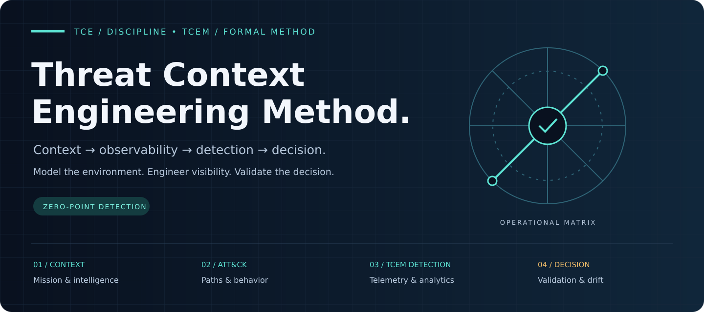

---
hide:
  - toc
---

# Intelligence that changes defensive decisions.

**Threat Context Engineering (TCE)** is the umbrella discipline. **Threat Context Engineering Method (TCEM)** is the formal workflow that connects mission, architecture, threat intelligence, MITRE-aligned behavior, telemetry, detection, validation and defensive decisions.

[Explore the method](methodology.md){ .md-button .md-button--primary }
[See practical examples](applicability.md){ .md-button .md-button--primary }
[Run the workbench](colab-frontend.md){ .md-button }

## Three ways into TCEM

-   **01 / Understand the context**

    ---

    Map crown jewels, trust boundaries, intelligence requirements and evidence before selecting controls.

    [Start the analyst workflow →](analyst-workflow.md)

-   **02 / Engineer visibility**

    ---

    Translate threat paths into telemetry contracts, detection specifications and reproducible validation.

    [Explore detection as code →](detection-validation-as-code.md)

-   **03 / Act with traceability**

    ---

    Find enterprise blind spots and choke points. Review proposed actions and record why each decision was made.

    [Discover TCEM Horizon →](horizon.md)

!!! tip "Zero-Point Detection"
    Model the threat **before the first log**. Ask what must be observable if an attack path happens, then design the telemetry and detection requirements.

## From context to operational evidence

| Understand | Engineer | Validate & decide |
| :--- | :--- | :--- |
| Mission, architecture, evidence and hypotheses | Attack paths, defensive controls, telemetry and detections | Validation evidence, intelligence gaps and Decision Trace |

[Browse executable reference cases](reference-cases.md){ .md-button }

!!! note "Keep uncertainty visible"
    Priority is separate from confidence. Horizon forecast pressure is **not attack probability**. AI suggestions and external intelligence require analyst review.

## Where TCEM becomes useful

-   **Identity / IAM**

    Privileged trust → identity-control change → telemetry requirement → correlated detection → decision.

-   **Cloud**

    Control-plane administration → policy change → target-context gap → validation.

-   **Software supply chain**

    Source/dependency change → artifact publication → provenance evidence → release-integrity control.

-   **AI agents**

    Agent authority → tool/connector action → machine-identity observability → review.

-   **Critical SaaS**

    Delegated administration → configuration change → third-party trust decision.

-   **ICS / OT**

    Engineering access → control change → visibility + recovery evidence.

[Open the complete applicability walkthrough →](applicability.md){ .md-button }

## The four inherited questions

TCEM keeps the four questions popularized by the Threat Modeling Manifesto:

1. What are we working on?
2. What can go wrong?
3. What are we going to do about it?
4. Did we do a good enough job?

It extends them with operational sub-questions:

- What is mission-critical?
- Which assets are crown jewels?
- Which adversaries and behaviors are relevant?
- Which enterprise exposure paths are plausible or becoming more defensively urgent?
- Which controls alter those paths?
- Which events must exist for those paths to be observable?
- Which detections and correlations prove we can see them?
- How will we validate the assumptions?
- What new CTI would cause us to change the model?

## Core artifacts

A complete TCEM assessment should leave behind:

- Mission map
- Crown-jewel register
- Architecture / trust-boundary map
- Threat-context register
- Enterprise Environment State (for Horizon assessments)
- Attack-path or Attack Flow model
- Prioritized scenario backlog
- Defensive-control mapping
- Telemetry contract
- Detection-use-case specification
- Validation evidence
- Detection-by-Absence findings
- Review-gated preemptive-action candidates
- Residual-risk statement
- Review date and owner

Start with the [Methodology](methodology.md).

## TCEM Horizon

For enterprise-wide analysis, TCEM Horizon adds a time-stamped Environment State and continuously prioritizes review-only paths from modeled exposure points toward crown jewels using architecture, controls, telemetry, vulnerability pressure and accepted threat intelligence.

Horizon forecast pressure is a defensive prioritization signal, not a prediction that a specific attack will occur.

Start with [TCEM Horizon](horizon.md) and [Enterprise Environment State](environment-state.md).
