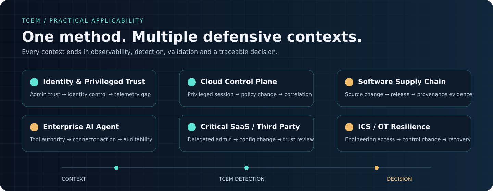

# Reference Cases

TCEM ships with one full enterprise case plus five compact executable reference cases. They are intentionally synthetic. Their purpose is to demonstrate the method, telemetry engineering and safe validation without smuggling somebody's production topology into a public Git repository. A surprisingly useful standard.

## Case map

| Case | Crown jewel | Modeled defensive sequence | ATT&CK | Telemetry / engineering focus | Validation |
|---|---|---|---|---|---|
| **enterprise-identity** | Enterprise identity control plane | privileged administrative context → identity configuration change | T1078, T1098 | identity actor/source/target, delegated trust, recovery | VAL-001 |
| **cloud-control-plane** | Cloud organization & privileged control plane | privileged cloud session → organization-wide policy change | T1078, T1098 | cloud audit, actor correlation, target context | VAL-CLOUD |
| **software-supply-chain** | Production release chain | source/dependency change → artifact publication | T1195 | pipeline provenance, artifact target, release integrity | VAL-SUPPLY |
| **ai-agent-enterprise** | Agent identity & sensitive connector authority | privileged agent authorization → sensitive connector action | T1078, T1098 | agent/tool/target telemetry, connector authority | VAL-AI |
| **critical-saas-third-party** | Critical SaaS administration plane | external admin session → critical configuration change | T1078, T1098 | delegated administration, source attribution, target config | VAL-SAAS |
| **ics-ot-resilience** | Industrial control & recovery authority | remote engineering session → control configuration change | T1078, T1021 | engineering audit, control target, resilience | VAL-OT |

The ATT&CK mappings are high-level reference mappings. They remain reviewable behavior vocabulary, not proof of attribution or an execution recipe.

## What every reference case demonstrates

~~~text
Mission
  ↓
Crown Jewel
  ↓
Threat Context
  ↓
Defensive Scenario
  ↓
ATT&CK behavior
  ↓
Telemetry Contract
  ↓
TCEM Detection
  ↓
Safe Validation
  ↓
Decision / Gap
~~~

Each compact reference case contains a case definition, crown jewel, architecture object, Threat Context, prioritized scenario, Telemetry Contract, Detection Specification, synthetic log-replay fixture and deterministic Validation object.

## 1. Enterprise identity: the complete case

**Practical question:** can a trusted administrative relationship become an enterprise identity-control path, and would the organization see the consequential change?

The case records:

- T1078 for privileged account/session use;
- T1098 for consequential account/identity configuration change;
- a partial Telemetry Contract because target.resource is not consistently present;
- an ordered-sequence Detection Specification;
- safe fixture validation;
- a decision to strengthen authentication, administrative scope and target-resource telemetry.

Run it:

~~~bash
tcem validate examples/cases/enterprise-identity
tcem operational-matrix examples/cases/enterprise-identity --offline
tcem telemetry-health examples/cases/enterprise-identity
tcem detection-backlog examples/cases/enterprise-identity
tcem validation-run examples/cases/enterprise-identity VAL-001
~~~

## 2. Cloud control plane

**Practical question:** after a privileged cloud session, can a consequential organization-wide policy change be correlated to the same actor with enough target context to support a decision?

~~~bash
tcem validate examples/reference-cases/cloud-control-plane
tcem validation-run examples/reference-cases/cloud-control-plane VAL-CLOUD
~~~

Expected engineering insight: the analytic exists, but target context is intentionally incomplete in the Telemetry Contract. TCEM surfaces the observability work instead of declaring victory because a rule file exists.

## 3. Software supply chain

**Practical question:** can an upstream source/dependency change be connected to publication of a trusted release artifact?

~~~bash
tcem validate examples/reference-cases/software-supply-chain
tcem validation-run examples/reference-cases/software-supply-chain VAL-SUPPLY
~~~

This demonstrates how T1195 can be used as behavior vocabulary while the real engineering work focuses on pipeline identity, provenance, artifact target and ordered release context.

## 4. Enterprise AI agent

**Practical question:** can a privileged agent/tool authorization be correlated with consequential activity through a sensitive connector?

~~~bash
tcem validate examples/reference-cases/ai-agent-enterprise
tcem validation-run examples/reference-cases/ai-agent-enterprise VAL-AI
~~~

The useful object is not merely “the model.” TCEM models agent identity, tool authority, connector trust and the telemetry needed to explain what the agent actually did.

## 5. Critical SaaS / third-party trust

**Practical question:** can an external administrative context be tied to a critical configuration change, and is delegated trust scoped tightly enough?

~~~bash
tcem validate examples/reference-cases/critical-saas-third-party
tcem validation-run examples/reference-cases/critical-saas-third-party VAL-SAAS
~~~

The resulting defensive work can include delegated-role review, source attribution, target-resource completeness and stronger revocation paths.

## 6. ICS / OT resilience

**Practical question:** can remote engineering access be correlated with a consequential control configuration change while preserving recovery context?

~~~bash
tcem validate examples/reference-cases/ics-ot-resilience
tcem validation-run examples/reference-cases/ics-ot-resilience VAL-OT
~~~

This case keeps the focus on engineering access, observability, resilient control and recovery. It does not reproduce operational attack procedures.

## Choose a case by team

| Team | Start with | Why |
|---|---|---|
| Security Architecture | enterprise-identity / cloud-control-plane | trust boundaries, crown jewels and control-plane decisions |
| CTI | enterprise-identity | evidence, hypotheses, local relevance and Decision Trace |
| SOC / Detection | cloud-control-plane / critical-saas-third-party | Telemetry Contracts and correlation |
| AppSec / Platform Engineering | software-supply-chain | provenance and release integrity |
| AI Security | ai-agent-enterprise | machine identity, tools and connectors |
| OT Security / Resilience | ics-ot-resilience | engineering visibility and recovery |

For the full walkthrough, see [TCEM in practice](applicability.md).
